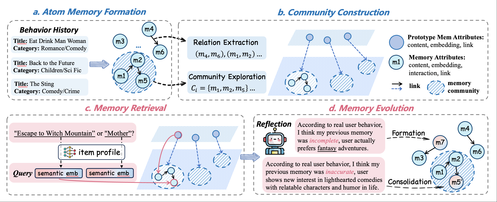

# STEAM

## 🚀 Quick Start





1. Write your own OpenAI API keys into ``props/steam_cd.yaml``, such as ``api_key_list: ['xxx', 'xxx']``.
2. Train to optimize user agent memory on CDs dataset and then evaluate the recommendation performance by:
    ```bash
    export api_base="Your openai.api_base"
    python run.py -m STEAM -d cd
    ```

## Environment
    ```bash
    conda create -n steam python=3.8
    pip install -r requirements.txt
    ```
    - torch==1.13.1
    - transformers==4.35.2

## Dataset
For **recommendation evaluation**, we follow the dataset processing strategy of **AgentCF** and preprocess the data into  
`dataset/cd/cd.train.inter`, `cd.valid.inter`, and `cd.test.inter`, which correspond to the training set, validation set, and test set, respectively.

For **simulation evaluation**, we follow the dataset processing strategy of **AFL** and preprocess the test data for evaluating the agent’s simulation capability into  
`dataset/cd/cd_sample100.sim.k1.inter`, `cd_sample100.sim.k3.inter`, and `cd_sample100.sim.k9.inter`, which represent positive-to-negative item ratios of **1:1**, **1:3**, and **1:9**, respectively.

